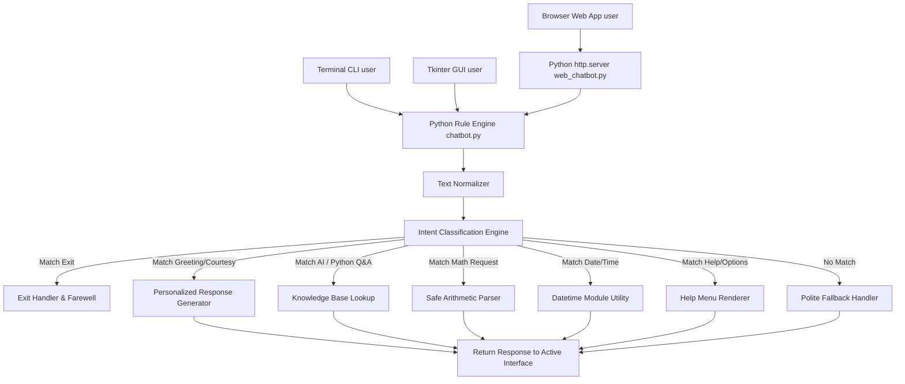

# B.Tech AI Minor Project Report: Smart AI Chatbot

---

## 📄 Cover Page Metadata

- **Project Title**: Smart AI Chatbot (CLI, Desktop GUI & Web Application)
- **Course**: B.Tech in Artificial Intelligence & Computer Science
- **Project Type**: Minor Project
- **Language**: Python 3.8+
- **Domain**: Artificial Intelligence / Natural Language Processing (NLP)

---

## 1. ABSTRACT

Conversational agents (chatbots) have transformed human-computer interaction by providing automated, intelligent response systems. This project presents **Smart AI Chatbot**, a rule-based conversational agent developed using core concepts of Natural Language Processing (NLP), such as regular expression pattern matching, keyword extraction, and deterministic intent classification. Built entirely with Python's standard libraries (`datetime`, `random`, `re`, `sys`, `math`, `tkinter`, `http.server`), the system operates without reliance on external frameworks, heavy machine learning libraries, or third-party APIs. 

The chatbot features **three interactive user interfaces**:
1. **Command Line Interface (CLI)** (`chatbot.py`)
2. **Desktop Graphical User Interface (GUI)** using Tkinter (`gui_chatbot.py`)
3. **Web Application Interface** served via built-in HTTP REST API (`web_chatbot.py` & `index.html`)

The system greets users, remembers session context, answers queries on Artificial Intelligence and Python programming, reports current temporal data, calculates arithmetic expressions safely, provides jokes and trivia, handles unrecognized inputs politely, and provides structured help menus. This project serves as a comprehensive demonstration of rule-based AI architecture suitable for academic evaluation and viva defense.

---

## 2. INTRODUCTION

Artificial Intelligence (AI) aims to build computing systems capable of simulating human cognitive functions such as learning, reasoning, and conversational understanding. Natural Language Processing (NLP) is a crucial subfield of AI focused on analyzing and generating human language text.

While modern conversational systems often use deep neural networks and large language models (LLMs), **rule-based chatbots** remain essential in domain-restricted environments, embedded devices, and privacy-focused applications. Rule-based systems offer deterministic behavior, zero operational API costs, immediate execution speed, and transparent logic flow.

This project implements a complete, multi-interface rule-based chatbot designed to provide educational assistance on AI and Python topics while incorporating utility features like arithmetic evaluation and date/time tracking.

---

## 3. PROBLEM STATEMENT

Users and novice programming students often require immediate answers to fundamental questions regarding Artificial Intelligence and Python syntax without navigating complex search engine results. Moreover, many AI educational projects rely heavily on cloud APIs (e.g., OpenAI API) or complex heavy frameworks (e.g., PyTorch, Rasa), making them expensive to run, hard to deploy offline, or difficult to explain during viva examinations.

**Challenge**: Build an offline, zero-dependency, modular Python chatbot capable of accurately interpreting user intents, maintaining session context, executing safe mathematical calculations, offering multiple user interfaces (CLI, GUI, Web), and responding politely to arbitrary user inputs.

---

## 4. OBJECTIVES

1. **Rule-Based NLP Engine**: Develop an intent recognition pipeline utilizing regular expressions (`re`) and keyword matching algorithms.
2. **Multi-Interface Architecture**: Provide three interfaces—Terminal CLI, Tkinter Desktop GUI, and Glassmorphic Web App.
3. **Session Memory**: Implement stateful tracking to store and personalize interactions using the user's name.
4. **Domain Knowledge Base**: Construct structured response matrices covering key concepts in AI (ML, DL, NLP) and Python (creator, syntax, data types).
5. **Safe Expression Parsing**: Build an arithmetic calculator module that evaluates math operations without exposing security risks associated with unconstrained `eval()`.
6. **Robust Error Handling**: Implement courteous fallback mechanisms for out-of-domain inputs and graceful termination handlers.
7. **Zero External Dependencies**: Ensure 100% compatibility with Python 3 standard libraries.

---

## 5. SCOPE OF THE PROJECT

The scope of this minor project encompasses:
- **CLI Interface**: Interactive terminal window with custom ASCII banners.
- **Tkinter Desktop GUI**: Sleek dark-mode desktop window with quick buttons, scrollable chat logs, and status bar.
- **Glassmorphic Web App**: HTML/CSS/JS frontend communicating with Python `http.server` backend via JSON REST API.
- **Rule Matching Categories**: Greetings, courtesy responses, AI definitions, Python tutorials, temporal utilities (date/time), arithmetic calculation, random entertainment (jokes & facts), help menu, and exit intent.
- **Academic Evaluation**: Comprehensive documentation and automated unit testing (`unittest`) tailored for B.Tech project defense.

---

## 6. AI CONCEPTS USED

```
+-------------------------------------------------------------------+
|                        AI & NLP PIPELINE                          |
+-------------------------------------------------------------------+
| 1. Text Normalization  : Case folding, whitespace stripping       |
| 2. Intent Detection    : Regex pattern matching & Keyword search   |
| 3. Entity Extraction   : Numerical & Operator parsing for math     |
| 4. State Management    : Session context & name tracking          |
| 5. Response Selection  : Deterministic & Random matrix choices    |
+-------------------------------------------------------------------+
```

1. **Text Preprocessing & Normalization**: Raw user strings undergo lowercase conversion, whitespace truncation, and punctuation handling.
2. **Regular Expression Pattern Matching**: Flexible pattern boundaries (`\b`) match variant spellings and synonyms (e.g., matching "hi", "hello", "hey", "good morning" under the *Greeting* intent).
3. **Intent Classification**: Evaluates input against ordered pattern rules. Upon matching, execution branches to specific response generator functions.
4. **Deterministic & Stochastic Response Generation**: Static Q&A queries return exact factual responses, while greetings and jokes use randomized selection routines (`random.choice`) to increase conversational dynamism.

---

## 7. SYSTEM ARCHITECTURE



---

## 8. MODULES & FUNCTIONS DESCRIPTION

### A. Core Rule Engine (`chatbot.py`)
- **`ChatState`**: Class maintaining session variables (`user_name`, `conversation_count`, `is_active`).
- **`get_current_date()`**: Formats local system date.
- **`get_current_time()`**: Formats local system time.
- **`safe_calculate(expression)`**: Sanitizes input string and evaluates arithmetic expressions safely.
- **`get_help_menu(user_name)`**: Renders styled help menu.
- **`process_response(user_input, state)`**: Central intent router matching greetings, courtesy, AI Q&A, Python Q&A, jokes, facts, and fallbacks.

### B. Desktop GUI Application (`gui_chatbot.py`)
- **`ChatbotGUI`**: Tkinter application window with modern dark theme styling, name entry bar, quick prompt toolbar, auto-scrolling chat log, and status bar.

### C. Web Application Server (`web_chatbot.py` & `index.html`)
- **`ChatbotHTTPRequestHandler`**: Custom handler serving `index.html` and handling POST requests to `/api/chat`.
- **`index.html`**: Glassmorphic HTML5/CSS3/JS user interface.

---

## 9. ALGORITHM / FLOW OF EXECUTION

```
ALGORITHM: Core Intent Processing Loop

Step 1: Start system (CLI, GUI, or Web Server).
Step 2: Initialize ChatState object.
Step 3: Receive input string from user.
Step 4: IF input is empty -> WAIT for next input.
Step 5: IF match_exit(input) is TRUE:
            Return farewell message and terminate session.
Step 6: Pass input and ChatState to process_response().
Step 7: Evaluate matching Intent Rule:
            - IF Help Intent -> Return help menu text.
            - IF Greeting Intent -> Return personalized greeting.
            - IF Courtesy Intent -> Return status/acknowledgment.
            - IF Date/Time Intent -> Fetch datetime and return string.
            - IF Math Intent -> Parse and evaluate expression.
            - IF AI Q&A Intent -> Lookup AI definition in Knowledge Base.
            - IF Python Q&A Intent -> Lookup Python information.
            - IF Joke/Fact Intent -> Select random item from dataset.
            - ELSE -> Return polite fallback error message.
Step 8: Render response string on user's active interface.
Step 9: Repeat process until session exit.
```

---

## 10. EXPECTED OUTPUT & SAMPLE CONVERSATION

Refer to [screenshots/sample_run.txt](file:///c:/Users/divya/OneDrive/Desktop/Smart_AI_Chatbot/screenshots/sample_run.txt) for raw execution outputs. Below is a sample snippet:

```text
Bot: Hello! Welcome to the Smart AI Chatbot system.
Bot: May I know your name, please? Divya Raj

Bot: Nice to meet you, Divya Raj! 👋
Bot: Type 'help' to see what I can do, or type 'bye' to exit.

----------------------------------------------------------------------

Divya Raj: What is Machine Learning?
Bot: 🧠 Machine Learning (ML) is a subfield of AI that enables systems to automatically learn and improve from experience without being explicitly programmed.

Divya Raj: Calculate 125 * 8
Bot: The result of (125 * 8) is **1000**.
```

---

## 11. ADVANTAGES & LIMITATIONS

### Advantages
1. **Zero External Dependencies**: Operates out-of-the-box on any standard Python installation.
2. **Multiple User Interfaces**: Supports CLI, Desktop GUI (Tkinter), and Web Browser App.
3. **High Execution Speed**: Microsecond response times with zero network latency.
4. **Safe Evaluation**: Protects host system against malicious script execution during math evaluation.
5. **Deterministic Accuracy**: Guarantees precise factual answers without generative hallucinations.

### Limitations
1. **Rule Constraint**: Cannot respond intelligently to out-of-vocabulary inputs outside pre-programmed regex patterns.
2. **Lack of Deep Context**: Does not retain multi-turn context beyond session state variables.
3. **Typo Sensitivity**: Minor misspellings may trigger fallback responses if regex patterns do not cover fuzzy matching.

---

## 12. FUTURE SCOPE & ENHANCEMENTS

1. **Voice Assistant Interface**: Integrating `pyttsx3` (Text-to-Speech) and `SpeechRecognition` for voice-driven interaction.
2. **Machine Learning Model Integration**: Replacing regex rules with TF-IDF vectorizers and Naive Bayes classifiers for intent detection.
3. **Database Persistent Memory**: Connecting an SQLite database to maintain chat history and user profiles across sessions.
4. **Cloud Deployment**: Packaging the Web Application backend with Docker or FastAPI for cloud hosting.

---

## 13. CONCLUSION

The **Smart AI Chatbot** project successfully demonstrates the principles of rule-based artificial intelligence and natural language processing across CLI, GUI, and Web platforms. By leveraging regex pattern matching, intent routing, and session state tracking in pure Python, the system delivers an interactive, reliable, and user-friendly conversational experience. The project achieves all academic requirements specified for a B.Tech AI Minor Project.
